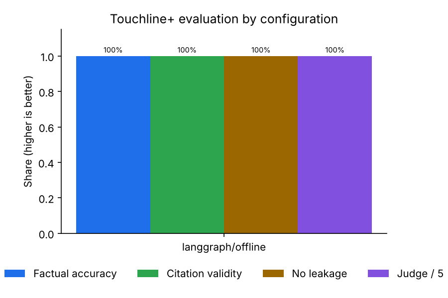
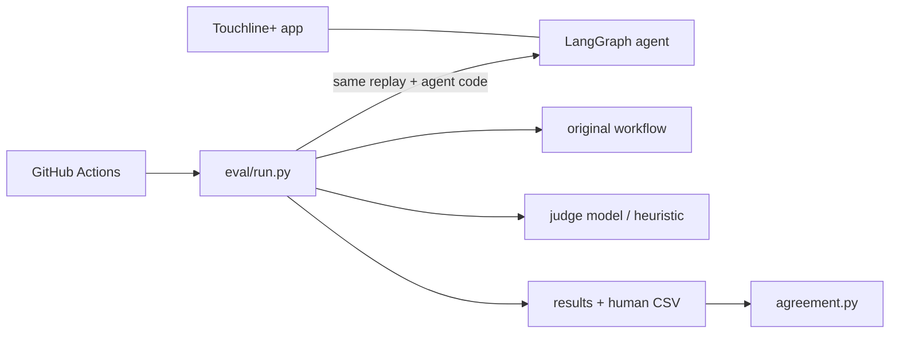
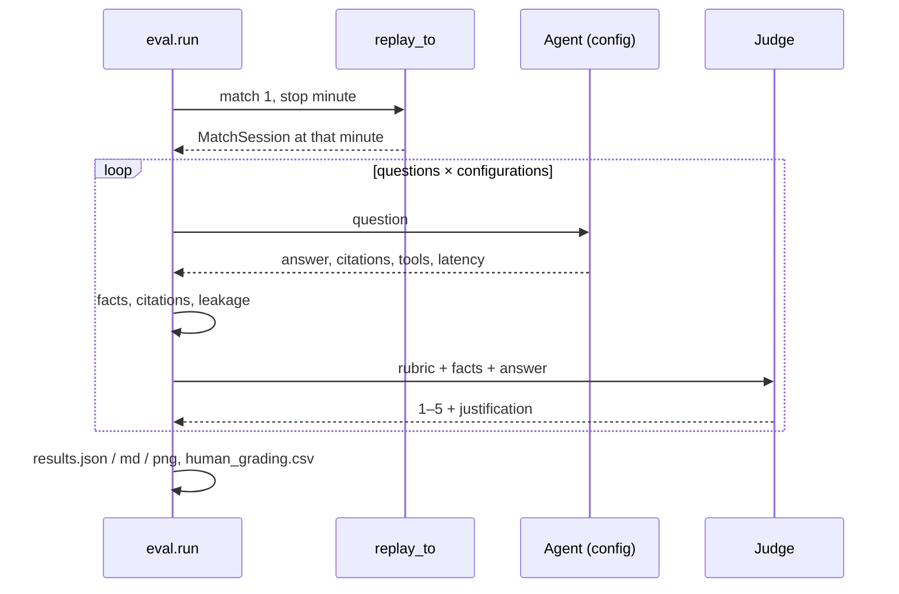
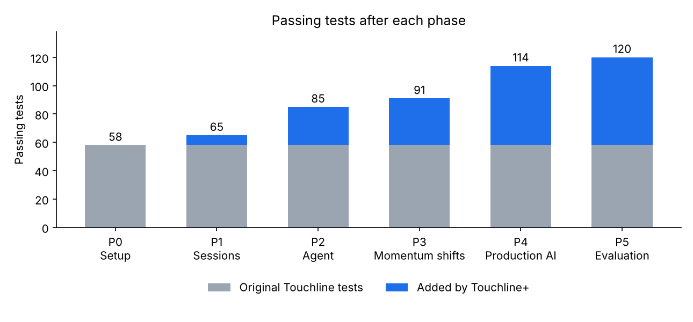

# Phase 5 — Evaluation harness

Branch: `phase-5-eval` (from `phase-4-production-ai`).

## What was built
- `eval/questions.json` — 30 match questions at stop minutes 20, 44, 70 and 89 of the synthetic match (score, shots, chances/xG, possession, field tilt, player passes and shots, a 15-minute window, momentum leader) with expected facts computed by the Python analytics, plus **6 definition questions** (RAG) whose expected fact is the source file. Generated by `eval/build_questions.py`.
- `eval/run.py` — replays to each stop minute with no sleeping, asks every configuration (original MAF vs LangGraph × Gemini / Foundry / Ollama when available, plus the offline baseline), skips missing ones with a reason, and reports **factual accuracy, citation validity, leakage, latency p50/p95, average tool calls**, definition retrieval hit@1/hit@3, and an **LLM-as-judge** score (rubric in `eval/rubric.md`, judge from a different provider where possible; a labelled heuristic when no model exists). Writes `results.json`, `results.md`, `results.png` and exports 20 answers to `human_grading.csv`.
- `eval/agreement.py` — judge vs human: exact-match rate, within-1 rate, Cohen's kappa (plain and quadratic-weighted), disagreements.
- `app/agent/offline.py` — a deterministic rule-based model (`GAME_CHAT_PROVIDER=offline`) used as the CI baseline and for a no-key demo.
- CI: GitHub Actions runs the 5-question eval subset offline.
- Guardrail fix found by the harness: "Shots 7-6" was flagged as a wrong scoreline; the score check now needs score context in the sentence.

## Results (this build, no API keys)
| Configuration | Questions | Factual accuracy | Citation validity | Leakage | Latency p50 / p95 (s) | Avg tool calls | Judge (1–5) |
| --- | --- | --- | --- | --- | --- | --- | --- |
| langgraph/offline | 36 | 100% | 100% | 0 | ≈0.035 / 0.048 | 1.22 | 5 (heuristic) |
| langgraph/gemini, maf/gemini | skipped: no key | | | | | | |
| langgraph/foundry, maf/foundry | skipped: no credentials | | | | | | |
| langgraph/ollama | skipped: not reachable | | | | | | |

Definition retrieval (hash embedder): hit@1 100%, hit@3 100% (6 questions).



**How to read this honestly:** the offline baseline reads the same tool outputs the expected facts come from, so 100% shows the pipeline (replay → session → tools → validator → leakage checks) is consistent and leak-free. It is **not** evidence of language-model quality. The comparison the LinkedIn post needs (MAF vs LangGraph, Gemini vs Ollama) appears automatically when keys/Ollama are available:

```bash
GAME_GEMINI_API_KEY=... pipenv run python -m eval.run
```

## Files touched
| File | Doc |
| --- | --- |
| `eval/*` (new) | [eval docs](../files/eval/README.md) |
| `app/agent/offline.py` (new) | [doc](../files/app/agent/offline.py.md) |
| `app/agent/llm.py`, `app/config.py`, `app/main.py`, `app/guardrails.py` | [llm](../files/app/agent/llm.py.md), [config](../files/app/config.py.md), [main](../files/app/main.py.md), [guardrails](../files/app/guardrails.py.md) |
| `tests/test_eval.py` (new) | [doc](../files/tests/test_eval.py.md) |
| `.github/workflows/checks.yml` | [doc](../files/.github/workflows/checks.yml.md) |
| `README.md` | [doc](../files/README.md.md) |

## Architecture after this phase

Full diagrams: [architecture.md](../architecture.md).

## Main flow (evaluation run)


## Test results
**120 passed** (114 + 6 new), 0 skipped; ruff clean; the CI eval command runs in about 1 s.



## Decisions to review
- **No keys:** only the offline baseline ran; the judge is the labelled heuristic. Please run the full harness with a Gemini key (and Ollama locally) to get the real comparison for the post, then grade `eval/human_grading.csv` and run `python -m eval.agreement`.
- Questions use the **synthetic match** (deterministic, offline, no licensing questions); StatsBomb matches are supported via `match_id` but need network access.
- Fact matching tolerances: xG ±0.006, percentages ±0.6, integers exact.
- The human CSV is only written when absent, so your grades are never overwritten.
- Push still blocked (403).

## Open issues
- The offline baseline cannot show model quality; real numbers depend on keys.
