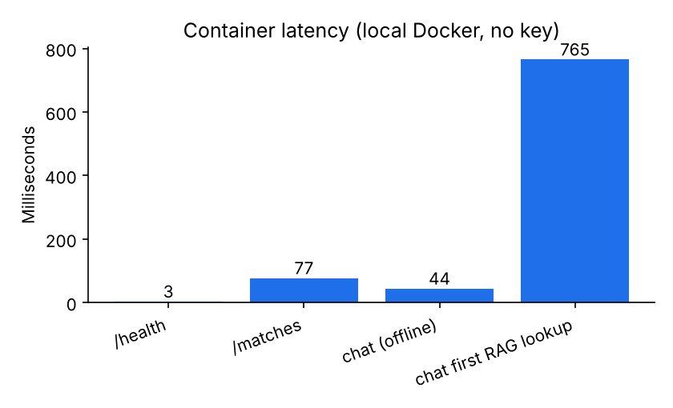
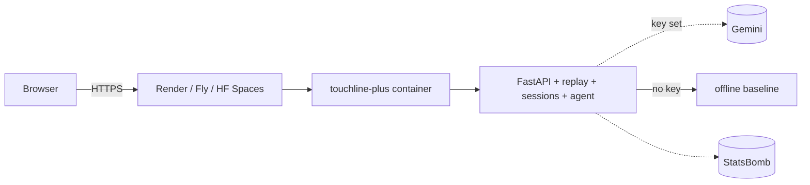
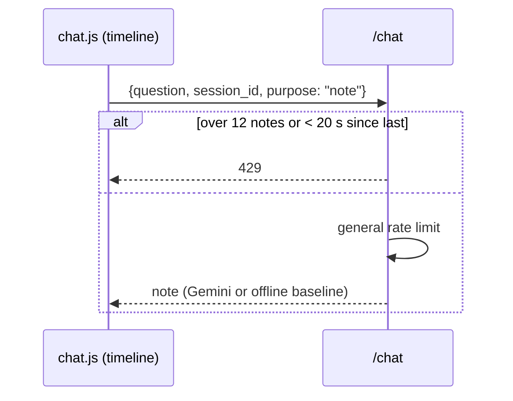
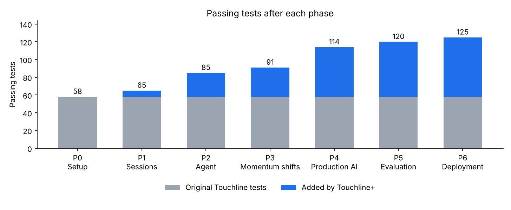

# Phase 6 — Deployment

Branch: `phase-6-deploy` (from `phase-5-eval`).

## What was built
- **Dockerfile** — `python:3.14-slim`, locked runtime dependencies, app + knowledge only, definitions index built at build time (hash embedder), non-root user, `$PORT`, proxy-proof health check. `.dockerignore` keeps the context small (no tests, docs, video).
- **Hosting** — `render.yaml` blueprint (free Docker web service, `/health`), plus Fly.io and Hugging Face Spaces steps in [docs/deploy.md](../deploy.md). Hosted demo uses Gemini; Ollama documented as local-only.
- **Works without a key** — `GAME_SOURCE=both` (synthetic match always listed; StatsBomb appended when reachable) and `GAME_CHAT_FALLBACK_OFFLINE=true` (Gemini with no key answers via the labelled offline baseline).
- **Rate limits per session** — general `/chat` limit (Phase 4) plus server-side timeline-note limits that mirror the original UI cooldowns (12 notes per replay, ≥ 20 s apart; `purpose: "note"`). The original client-side cooldowns are unchanged.
- **CI** — GitHub Actions: ruff, pytest, eval subset (Phase 5) and a new `docker` job that builds the image, runs it and polls `/health`.
- `GAME_MAX_SESSIONS` / `GAME_SESSION_TTL_SECONDS` for small hosts.

## Verification (local Docker 29.9)
- Image builds (≈ 1.1 GB) and reaches `healthy`.
- With **no key and no outbound network**: `/matches` lists the synthetic match (StatsBomb fallback exercised), a replay streams, chat answers via the offline baseline, `lookup_definition` cites `knowledge/field-tilt.md`, process runs as `touchline`.
- Cold start ≈ 2.2 s; ≈ 123 MiB after a replay.

The Docker Hub pull was rate-limited (HTTP 429) in the build sandbox, so the base image was pulled from `mirror.gcr.io` and a local-only layer added the sandbox proxy certificate. The repository's Dockerfile is unchanged by this; CI on GitHub builds it directly.

## Files touched
| File | Doc |
| --- | --- |
| `Dockerfile`, `.dockerignore`, `render.yaml` (new) | [Dockerfile](../files/Dockerfile.md), [.dockerignore](../files/.dockerignore.md), [render.yaml](../files/render.yaml.md) |
| `app/catalog.py` (new) | [doc](../files/app/catalog.py.md) |
| `app/main.py`, `app/config.py`, `app/chat.py`, `app/agent/llm.py`, `app/agent/service.py` | [main](../files/app/main.py.md), [config](../files/app/config.py.md), [chat](../files/app/chat.py.md), [llm](../files/app/agent/llm.py.md), [service](../files/app/agent/service.py.md) |
| `app/static/chat.js` | [doc](../files/app/static/chat.js.md) |
| `tests/test_deploy.py` (new), `tests/test_agent.py` | [deploy](../files/tests/test_deploy.py.md), [agent](../files/tests/test_agent.py.md) |
| `.github/workflows/checks.yml`, `.env.example`, `README.md` | [workflow](../files/.github/workflows/checks.yml.md), [.env.example](../files/.env.example.md), [README](../files/README.md.md) |
| `docs/deploy.md` (new) | — |

## Architecture after this phase

Full diagrams: [architecture.md](../architecture.md).

## Main flow changed (timeline note)

## Test results
**125 passed** (120 + 5 new), 0 skipped; ruff clean.

## Decisions to review
- **Not deployed**: no hosting account in this environment. Follow [docs/deploy.md](../deploy.md) (Render blueprint recommended) and set `GAME_GEMINI_API_KEY` as a secret.
- Hosted image uses the **hash embedder** (no model download at build or runtime). Switch to `GAME_RAG_EMBEDDER=fastembed` if the host can reach Hugging Face; rebuild so the index matches.
- Gemini without a key **falls back to the offline baseline** by default (label shown in the UI); set `GAME_CHAT_FALLBACK_OFFLINE=false` to return 503 instead.
- Hosted limits: 6 questions/min/session, $0.05 budget per replay, 50 sessions.
- Push still blocked (403).

## Open issues
- In-memory state → single instance only.
- Image size (≈ 1.1 GB) could shrink with an optional "no-RAG" build.
