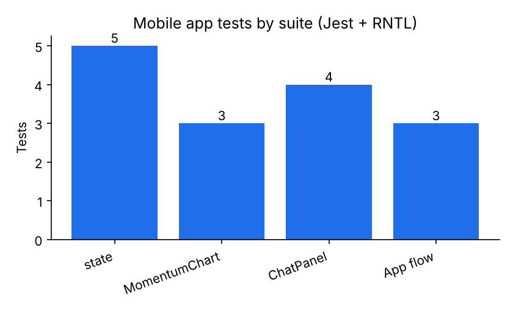
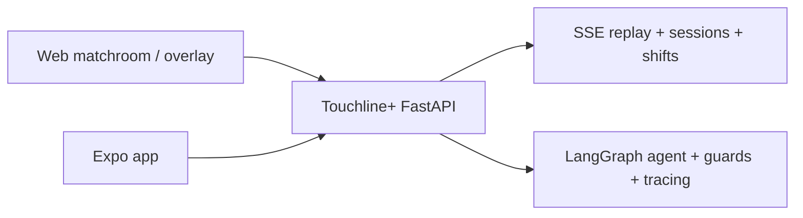
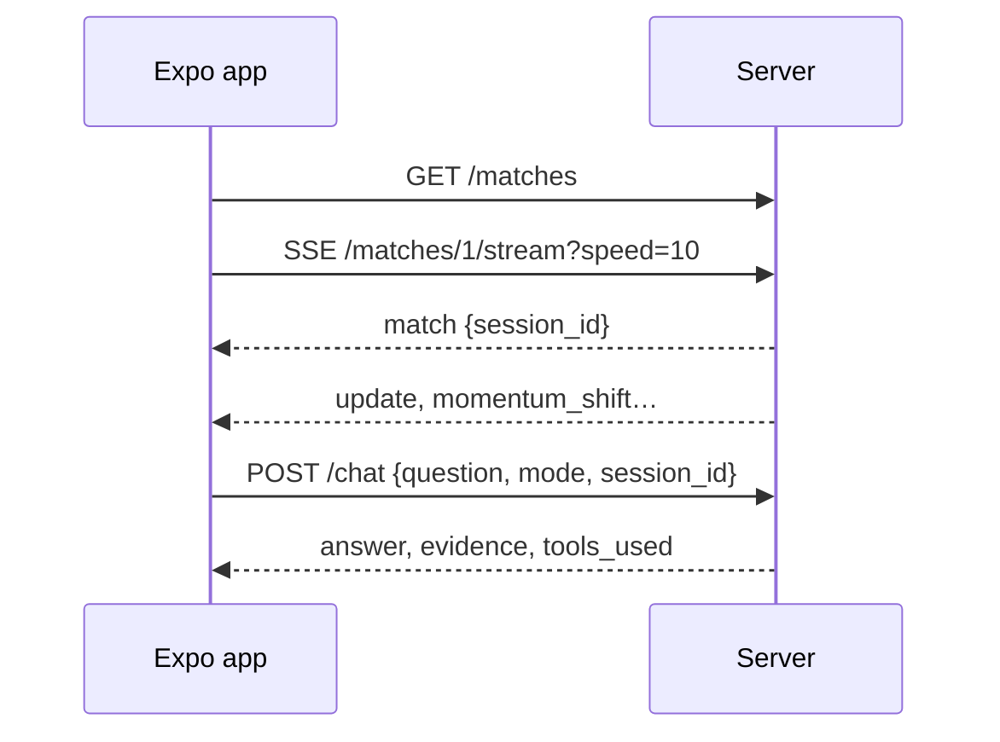
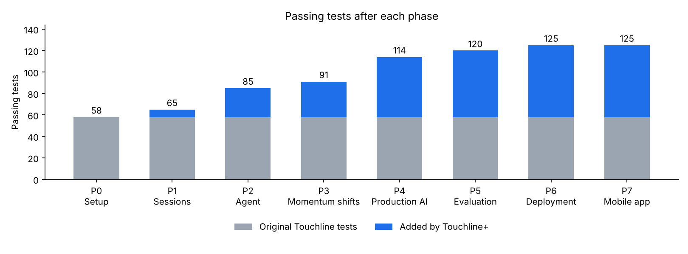

# Phase 7 (stretch) — Expo second-screen app

Branch: `phase-7-mobile` (from `phase-6-deploy`). Done last, after Phases 0–6 were committed. Their **push was blocked** (see Decisions).

## What was built
`mobile/` — an Expo (SDK 58, TypeScript) app:
- **Pick a match** from `/matches` (clear message when the server is unreachable).
- **Subscribe to the stream** with `react-native-sse` (named `match`, `update`, `momentum_shift`, `complete` events; automatic reconnect disabled so a reconnect never silently creates a new server session).
- **Score, clock and xG** scoreboard; **momentum chart** (filled xT proxy, one point per minute, arrow markers for shifts) drawn with `react-native-svg`.
- **Shift notes** with narration, minutes and players.
- **Chat** sending only `{question, mode, session_id}`; shows evidence, the agent's tool trace and provider.
- Pure reducer (`src/state.ts`) so stream handling is unit-tested without a device.

## Verification
- `npx tsc --noEmit`: clean (strict, no unused locals/params).
- `npx jest`: **15 passed** in 4 suites (Jest 30 + React Native Testing Library 14 with `test-renderer` 1.3; `fetch` and `EventSource` mocked).
- `npx expo install --check` (offline table): dependencies match SDK 58.
- Not run on a device or simulator (none available here), as agreed.
- Python suite unchanged: **125 passed**.

## Files touched
| File | Doc |
| --- | --- |
| `mobile/**` (new) | [mobile docs](../files/mobile/README.md) |
| `.github/workflows/checks.yml` (new `mobile` job) | [doc](../files/.github/workflows/checks.yml.md) |
| `README.md` | [doc](../files/README.md.md) |

## Architecture after this phase

Full diagrams: [architecture.md](../architecture.md).

## Main flow (phone)

## Test results
Python: **125 passed** (unchanged). Mobile: **15 passed**, `tsc` clean.

## Decisions to review
- **react-native-svg instead of Skia / victory-native** for the chart: no native canvas mocks needed in Jest and a smaller dependency set; the chart is simple enough.
- **RNTL 14** requires async `render`/`fireEvent`/`act` (React 19 model) and `test-renderer` 1.3 to match React 19.3.
- TypeScript **5.9** rather than 7.0 (the new native compiler), to keep `tsc --noEmit` on the toolchain Expo documents.
- API URL comes from `EXPO_PUBLIC_API_URL` (no `expo-constants` dependency).
- Chat uses `/chat` (not streaming) on mobile for now.
- Push blocked (403) for every branch, including this one.

## Open issues
- Untested on real devices; check Android cleartext HTTP if your server is plain `http://` (use HTTPS hosting or allow cleartext for development).
- No pitch/chain highlight on mobile yet.
